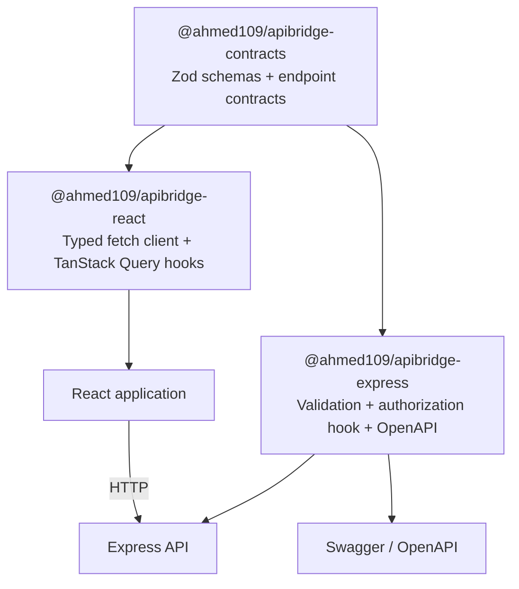

# 🌉 ApiBridge

[](https://github.com/Ahmed1092002/ApiBridge/actions/workflows/ci.yml)
[](LICENSE)

> **A type-safe REST contract toolkit for full-stack TypeScript applications.**

ApiBridge lets you define an API endpoint once with Zod, then reuse that contract on the server and the client. It removes duplicated request/response types, validates requests at runtime, generates OpenAPI documentation, and provides typed React Query hooks.

---

> [!IMPORTANT]
> **What ApiBridge does—and does not—do:**
>
> - **It is not an authentication provider.** Plug your own session, JWT, OAuth, or tenancy logic into the `authorize` callback.
> - **Client-side typing is not security.** The React package improves correctness and UX; authorization must always be enforced by the backend.
> - **The demo uses in-memory data.** It is for experimenting with the contract flow, not a production persistence layer.

---

## 🏗️ Architecture



The same contract becomes the single source of truth for:

- request `params`, `query`, `headers`, and `body` validation;
- typed response data and structured API errors;
- endpoint metadata, permissions, and OpenAPI security requirements;
- React Query `useQuery` and `useMutation` endpoints.

---

## 📦 Packages

| Package                                                                                        | Purpose                                                                                                    |
| ---------------------------------------------------------------------------------------------- | ---------------------------------------------------------------------------------------------------------- |
| [`@ahmed109/apibridge-contracts`](https://www.npmjs.com/package/@ahmed109/apibridge-contracts) | Framework-independent Zod contracts, inferred request/response types, and reusable standard error schemas. |
| [`@ahmed109/apibridge-express`](https://www.npmjs.com/package/@ahmed109/apibridge-express)     | Express route wrapper with runtime validation, authorization hook, and OpenAPI/Swagger generation.         |
| [`@ahmed109/apibridge-react`](https://www.npmjs.com/package/@ahmed109/apibridge-react)         | Typed REST client and TanStack Query hooks generated from the same endpoint contracts.                     |

---

## 🚀 Installation

### Backend

```bash
npm install @ahmed109/apibridge-contracts @ahmed109/apibridge-express express zod
```

### React frontend

```bash
npm install @ahmed109/apibridge-contracts @ahmed109/apibridge-react @tanstack/react-query zod
```

---

## 💡 End-to-end example

### 1. Define a shared contract

```ts
import { z } from "zod";
import { defineRoute, standardErrors } from "@ahmed109/apibridge-contracts";

export const getProject = defineRoute({
  method: "get",
  path: "/teams/:teamId/projects/:projectId",
  summary: "Get a project",
  params: z.object({ teamId: z.string(), projectId: z.string() }),
  query: z.object({ include: z.array(z.enum(["tasks", "members"])).optional() }),
  headers: z.object({ "x-tenant-id": z.string().min(1) }),
  auth: "required",
  permissions: ["projects.read"],
  security: [{ bearerAuth: [] }],
  responses: {
    200: z.object({ id: z.string(), name: z.string() }),
    400: standardErrors[400],
    401: standardErrors[401],
  },
});
```

### 2. Mount it in Express

```ts
import express from "express";
import {
  ApiBridge,
  errorHandler,
  generateOpenApiDocument,
  setupSwaggerDocs,
} from "@ahmed109/apibridge-express";
import { getProject } from "./contracts";

const app = express();
app.use(express.json());

const bridge = new ApiBridge({
  authorize: async ({ req, auth, permissions }) => {
    const user = await getUserFromSession(req);
    if (auth === "required" && !user) throw new Error("UNAUTHORIZED");
    await assertPermissions(user, permissions);
  },
});

app.get(
  getProject.path,
  bridge.route(getProject, async ({ params, query, headers }) => ({
    status: 200,
    body: await projects.get({ ...params, ...query, tenantId: headers["x-tenant-id"] }),
  })),
);

const spec = generateOpenApiDocument([getProject], {
  info: { title: "Projects API", version: "1.0.0" },
  securitySchemes: { bearerAuth: { type: "http", scheme: "bearer", bearerFormat: "JWT" } },
});

setupSwaggerDocs(app, "/docs", spec);
app.use(errorHandler());
```

### 3. Consume it from React

```tsx
import { createApiClient } from "@ahmed109/apibridge-react";
import { getProject } from "./contracts";

const api = createApiClient({
  baseUrl: "https://api.example.com",
  contracts: { projects: { get: getProject } },
  getHeaders: () => ({ Authorization: `Bearer ${token}`, "x-tenant-id": activeTenantId }),
});

const project = api.projects.get.useQuery({
  params: { teamId: "team-1", projectId: "project-7" },
  query: { include: ["tasks", "members"] },
});
// GET /teams/team-1/projects/project-7?include=tasks&include=members
```

---

## ✨ Key capabilities

### Contracts and validation

- Zod-backed validation for params, query strings, headers, and JSON bodies.
- Inferred TypeScript types without separately writing interfaces.
- Optional response validation during development to catch backend contract drift.
- Reusable structured `400`, `401`, `404`, and `500` error schemas.

### Authorization and metadata

- Endpoint-level `auth: "public" | "optional" | "required"` metadata.
- Application-defined permissions such as `projects.read` or `billing.export`.
- A framework-neutral `authorize` callback—no lock-in to a specific identity provider.
- Optional OpenAPI security declarations and custom security schemes.

### React client

- Typed `fetch`, `useQuery`, `useMutation`, query keys, error states, and response data.
- Any named path parameter works: `/teams/:teamId/projects/:projectId` is supported, not only `:id`.
- Arrays serialize as repeated query keys by default: `tag=react&tag=typescript`.
- Custom `serializeQuery` support for APIs with a different query convention.

---

## 🧪 Demo applications

The repository contains a working task-management example:

| App                   | URL                          | What it demonstrates                                                                    |
| --------------------- | ---------------------------- | --------------------------------------------------------------------------------------- |
| `apps/demo-api`       | `http://localhost:4000`      | Express endpoints, runtime validation, protected mutations, and generated Swagger docs. |
| `apps/demo-dashboard` | `http://localhost:5173`      | React dashboard consuming the same contracts through typed hooks.                       |
| Swagger UI            | `http://localhost:4000/docs` | OpenAPI document generated from contract definitions.                                   |

### Run locally

```bash
pnpm install
pnpm build
pnpm dev
```

---

## 🧪 Quality checks

```bash
pnpm lint      # ESLint across packages and demo apps
pnpm test      # Vitest: contracts, Express adapter, React client
pnpm build     # TypeScript package and demo builds
pnpm format    # Prettier check
```

The suite covers contract inference, request validation, headers, authorization hooks, OpenAPI metadata, nested route parameters, and repeated query serialization.

---

## 🗺️ Roadmap

- [ ] CLI scaffolding (`apibridge init`, `apibridge add-route`).
- [ ] Generated typed clients for non-React consumers.
- [ ] API versioning helpers.
- [ ] Retry and resilience policies for the React client.
- [ ] Changesets-based npm release workflow.
- [ ] Optional adapters for Fastify and React Native.

---

## 📄 License

MIT © 2026 ApiBridge Contributors. See [LICENSE](LICENSE).

## 🔗 Repository

[github.com/Ahmed1092002/ApiBridge](https://github.com/Ahmed1092002/ApiBridge)
