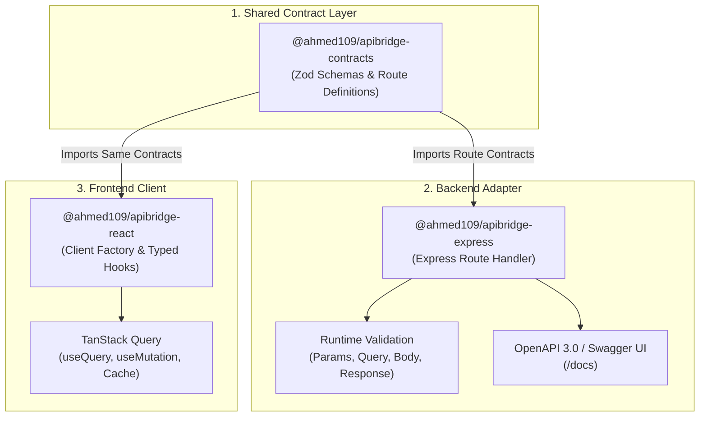

# ApiBridge

> **Production-quality, type-safe REST API contract toolkit for full-stack TypeScript applications.**

ApiBridge eliminates type drift and duplicated endpoint definitions between frontend and backend. By defining API routes, request parameters, queries, bodies, and responses once with [Zod](https://zod.dev), ApiBridge guarantees end-to-end type safety, runtime request validation, automated Swagger/OpenAPI documentation generation, and fully typed React hooks.

---

## The Problem ApiBridge Solves

In modern full-stack web development, frontend and backend teams face persistent challenges:

1. **Schema and Type Drift**: Backend changes an endpoint parameter or response field, but frontend TypeScript types are updated manually, leading to silent runtime crashes in production.
2. **Duplicated Boilerplate**: Developers write route declarations in Express, runtime validation schemas in libraries like Joi or Celebrate, TypeScript interfaces for models, OpenAPI/Swagger decorators, and frontend API client wrappers.
3. **No Guaranteed Runtime Adherence**: Frontend contracts often assume success structures while backend implementations return undocumented errors or inconsistent JSON payloads.

**ApiBridge solves this by providing a single source of truth:**
Define the contract once. Express enforces validation and generates OpenAPI specs automatically; React hooks consume the contract with zero manual typing.

---

## Architecture & Flow



### Shared Contract Flow:

1. **Contract Definition (`@ahmed109/apibridge-contracts`)**: Pure TypeScript contracts define paths, HTTP methods, headers, parameters, request body schemas, and response status codes using Zod.
2. **Express Validation & OpenAPI (`@ahmed109/apibridge-express`)**: The backend mounts handlers with `apiBridge.route(contract, handler)`. Incoming requests are parsed and validated against the Zod schemas; malformed requests immediately receive standard `400 VALIDATION_ERROR` responses. Outgoing responses are validated in development to prevent schema leakage. Swagger UI is generated directly from the contracts.
3. **React Typed Hooks (`@ahmed109/apibridge-react`)**: Frontend applications instantiate a typed client via `createApiClient({ baseUrl, contracts })`. Hooks like `useQuery` and `useMutation` automatically provide typed arguments, typed responses, query keys, and error structures.

---

## Monorepo Structure

```text
apibridge/
├── apps/
│   ├── demo-api/              # Express backend with seeded in-memory store & /docs Swagger
│   └── demo-dashboard/        # Vite + React + Tailwind CSS Task Management console
├── packages/
│   ├── contracts/             # Framework-agnostic Zod route contracts & error schemas
│   ├── express/               # Express adapter, runtime validation, & OpenAPI generator
│   └── react/                 # Typed client factory & TanStack Query hooks
├── docs/                      # Architectural assets and guides
├── pnpm-workspace.yaml        # pnpm monorepo workspace definition
├── tsconfig.base.json         # Strict TypeScript root configuration
├── vitest.config.ts           # Vitest root test configuration
└── README.md
```

---

## Installation

```bash
# In your pnpm workspace:
pnpm add @ahmed109/apibridge-contracts
pnpm add @ahmed109/apibridge-express # For backend
pnpm add @ahmed109/apibridge-react @tanstack/react-query # For React frontend
```

---

## Quickstart & Usage Examples

### 1. Define Contract (`@ahmed109/apibridge-contracts`)

```typescript
import { z } from "zod";
import { defineRoute, standardErrors } from "@ahmed109/apibridge-contracts";

export const TaskSchema = z.object({
  id: z.string(),
  title: z.string().min(1),
  status: z.enum(["todo", "in_progress", "done"]),
  priority: z.enum(["low", "medium", "high"]),
  createdAt: z.string().datetime(),
});

export const createTaskContract = defineRoute({
  method: "post",
  path: "/api/tasks",
  summary: "Create a new task",
  tags: ["Tasks"],
  body: z.object({
    title: z.string().min(1).max(100),
    priority: z.enum(["low", "medium", "high"]).default("medium"),
  }),
  responses: {
    201: TaskSchema,
    400: standardErrors[400],
    401: standardErrors[401],
  },
});
```

### 2. Implement Route in Express (`@ahmed109/apibridge-express`)

```typescript
import express from "express";
import {
  apiBridge,
  errorHandler,
  setupSwaggerDocs,
  generateOpenApiDocument,
} from "@ahmed109/apibridge-express";
import { createTaskContract } from "@ahmed109/apibridge-contracts";

const app = express();
app.use(express.json());

// Type-safe route wrapper with automatic Zod validation:
app.post(
  createTaskContract.path,
  apiBridge.route(createTaskContract, async ({ body, req }) => {
    // `body` is inferred as: { title: string; priority: "low" | "medium" | "high" }
    const newTask = {
      id: "task-1",
      title: body.title,
      priority: body.priority,
      status: "todo" as const,
      createdAt: new Date().toISOString(),
    };

    return {
      status: 201,
      body: newTask,
    };
  }),
);

// Mount OpenAPI 3.0 documentation at /docs
const spec = generateOpenApiDocument([createTaskContract], {
  info: { title: "Task API", version: "1.0.0" },
});
setupSwaggerDocs(app, "/docs", spec);

// Centralized error middleware
app.use(errorHandler());

app.listen(4000);
```

### 3. Consume in React (`@ahmed109/apibridge-react`)

```tsx
import React from "react";
import { createApiClient } from "@ahmed109/apibridge-react";
import { taskContracts } from "@ahmed109/apibridge-contracts";

const api = createApiClient({
  baseUrl: "http://localhost:4000",
  contracts: { tasks: taskContracts },
  getHeaders: () => ({
    "x-demo-user-id": "user-1",
  }),
});

export function TaskList() {
  // Fully typed query hook:
  const { data, isLoading, error } = api.tasks.list.useQuery({
    status: "todo",
    page: 1,
    limit: 10,
  });

  // Fully typed mutation hook:
  const createTask = api.tasks.create.useMutation();

  const handleCreate = () => {
    createTask.mutate({
      title: "Build ApiBridge",
      priority: "high",
    });
  };

  if (isLoading) return <div>Loading tasks...</div>;
  if (error) return <div>Error: {error.message}</div>;

  return (
    <div>
      <button onClick={handleCreate}>Add Task</button>
      <ul>
        {data?.items.map((task) => (
          <li key={task.id}>
            {task.title} ({task.priority})
          </li>
        ))}
      </ul>
    </div>
  );
}
```

---

## API Endpoints Table

| Method   | Path             | Summary                                  | Auth Required          | Request Payload                                                   | Response (Success)                     |
| -------- | ---------------- | ---------------------------------------- | ---------------------- | ----------------------------------------------------------------- | -------------------------------------- |
| `GET`    | `/api/me`        | Current user profile                     | Yes (`x-demo-user-id`) | None                                                              | `200 User`                             |
| `GET`    | `/api/tasks`     | List tasks (filtered, sorted, paginated) | No                     | Query: `status, priority, search, page, limit, sortBy, sortOrder` | `200 TaskListResponse`                 |
| `GET`    | `/api/tasks/:id` | Get task by ID                           | No                     | Params: `id`                                                      | `200 Task`                             |
| `POST`   | `/api/tasks`     | Create task                              | Yes (`x-demo-user-id`) | Body: `CreateTaskInput`                                           | `201 Task`                             |
| `PATCH`  | `/api/tasks/:id` | Partial update task                      | Yes (`x-demo-user-id`) | Params: `id`, Body: `UpdateTaskInput`                             | `200 Task`                             |
| `DELETE` | `/api/tasks/:id` | Delete task                              | Yes (`x-demo-user-id`) | Params: `id`                                                      | `200 { success: boolean, id: string }` |

### Standard Error Envelopes

ApiBridge enforces structured error contracts across all endpoints:

- `400 VALIDATION_ERROR`: Includes array of issue paths (`path: ["body", "title"]`), validation code, and error message.
- `401 UNAUTHORIZED`: Returned when `x-demo-user-id` is absent or unauthenticated on protected routes.
- `404 NOT_FOUND`: Returned when the target resource (e.g. task ID) does not exist.
- `500 INTERNAL_SERVER_ERROR`: Returned on uncaught exceptions or schema validation failures during development.

---

## Local Development Setup

### Prerequisites

- Node.js >= 18 (recommended Node 22+)
- pnpm >= 9

### Installation & Run

```bash
# 1. Install all dependencies across workspaces
pnpm install

# 2. Build contracts and helper packages
pnpm build

# 3. Start both demo API and demo dashboard concurrently
pnpm dev
```

Once running:

- **Demo Dashboard**: [http://localhost:5173](http://localhost:5173)
- **Demo API**: [http://localhost:4000](http://localhost:4000)
- **Interactive Swagger / OpenAPI UI**: [http://localhost:4000/docs](http://localhost:4000/docs)

---

## Testing & Quality Commands

```bash
# Run Vitest test suites across contracts, express, and react packages
pnpm test

# Run TypeScript build verification
pnpm build

# Run ESLint across monorepo
pnpm lint

# Check code formatting with Prettier
pnpm format
```

---

## Application Screenshots

|                                     Overview Dashboard                                      |                                   Tasks Management                                    |
| :-----------------------------------------------------------------------------------------: | :-----------------------------------------------------------------------------------: |
| _(Screenshot: Overview metrics, status counts, priority distribution, and recent activity)_ | _(Screenshot: Filterable task table with status badges, pagination, and CRUD modals)_ |

|                                   Interactive API Explorer                                    |                         Swagger / OpenAPI UI (/docs)                         |
| :-------------------------------------------------------------------------------------------: | :--------------------------------------------------------------------------: |
| _(Screenshot: Endpoint selector, schema viewer, live payload runner, and response inspector)_ | _(Screenshot: Complete auto-generated OpenAPI 3.0 Swagger UI documentation)_ |

---

## Roadmap

- [ ] **PostgreSQL Persistence**: Replace in-memory repository with Prisma / Drizzle ORM adapter.
- [ ] **JWT Authentication**: Add bearer token header extraction, refresh token rotation, and role-based permissions.
- [ ] **CLI Code Generator**: Command-line scaffolding utility (`apibridge init`, `apibridge add-route`).
- [ ] **API Versioning**: URL and header-based route contract versioning (`/v1`, `/v2`).
- [ ] **npm Publishing Pipeline**: Automated semantic versioning and publishing to npm.
- [ ] **Request Retry & Resilience**: Exponential backoff retry policies integrated into `@ahmed109/apibridge-react`.
- [ ] **React Native Support**: Adapter for cross-platform iOS & Android mobile clients.

---

## License

MIT © ApiBridge Contributors
